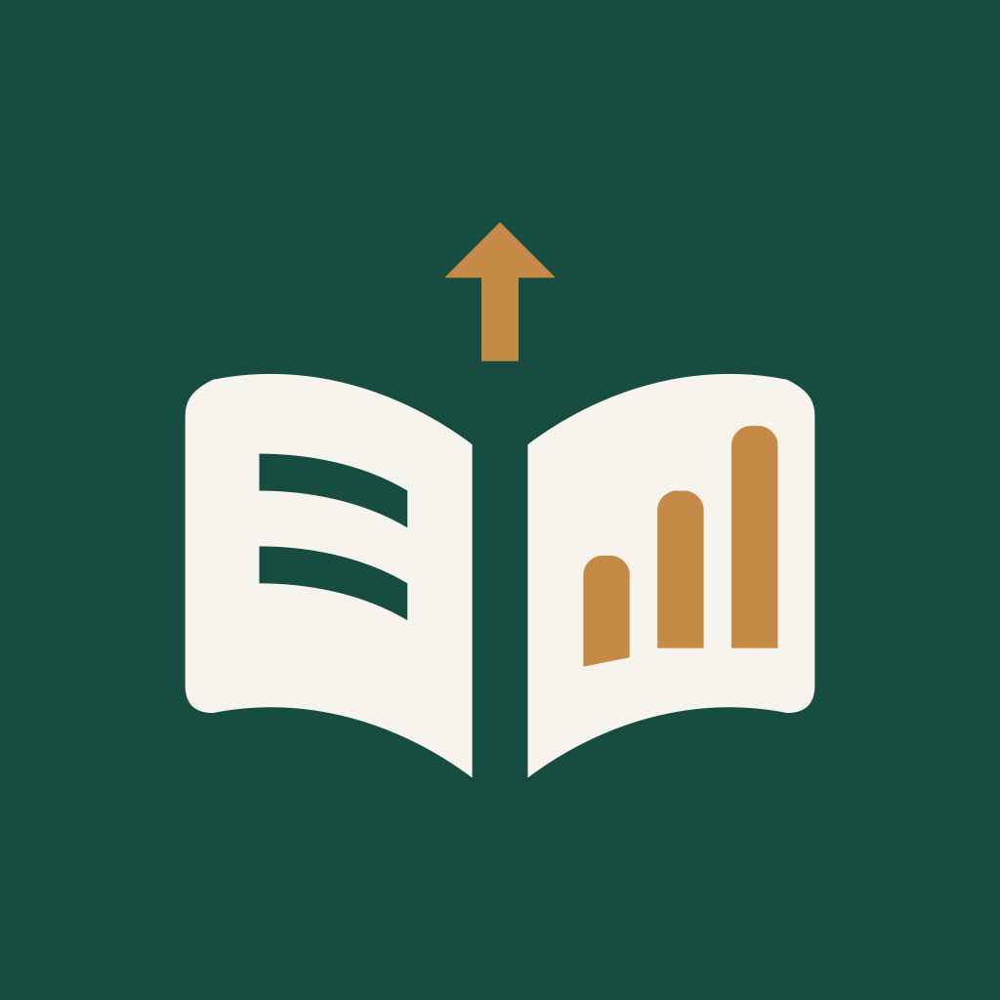

# NovelRank 应用图标

墨绿底色、米白书页与金色上升榜单。矢量源文件为 [app-icon.svg](app-icon.svg)，三端使用同一图形；没有文字或第三方网站标识。



## 资源接入

| 平台 | 资源与入口 |
| --- | --- |
| Android | `androidApp/src/main/res/`：API 26+ 自适应图标、API 33+ 单色主题图标；Manifest 的 icon/roundIcon 均引用 `@mipmap/ic_launcher` |
| iOS | `iosApp/iosApp/Assets.xcassets/AppIcon.appiconset`：18 个 iPhone/iPad/商店槽位，共 13 张无透明通道 PNG；已加入 Xcode Resources 和共享 AppIcon 配置 |
| Desktop | 窗口及支持的 Dock 使用 `composeApp/src/desktopMain/resources/icons/app-icon.png`；安装包使用本目录 ICNS、ICO，Linux 使用同一桌面 PNG |

iOS 使用完整方形背景，由系统处理圆角；Android 的前景保留自适应安全区，并提供书页镂空的单色版；桌面文件包含圆角与透明外边距。

## 重新导出

在 macOS 仓库根目录运行，无需安装额外依赖，也不会构建应用：

```bash
swift scripts/export-icons.swift
```

脚本读取 SVG，导出 Android 路径/背景色、iOS 所需尺寸、桌面 PNG、六尺寸 ICO 和多尺寸 ICNS。修改图形时保留 SVG 中的路径顺序（两页、两行文字、三根柱形、箭头）和标志平移；变更图形结构时同步更新单色镂空分组。

平台规则参考：[Android 自适应图标](https://developer.android.com/develop/ui/compose/system/icon_design_adaptive)、[Apple AppIcon 目录格式](https://developer.apple.com/library/archive/documentation/Xcode/Reference/xcode_ref-Asset_Catalog_Format/AppIconType.html)、[Compose 桌面图标配置](https://kotlinlang.org/docs/multiplatform/compose-native-distribution.html#application-icon)。

## 本次验证

2026-11-03：资源导出成功；检查 Android XML 与引用、iOS 18 个槽位的尺寸及 RGB 格式、Xcode asset 引用、ICO 六个帧和 ICNS 文件头，均通过。`plutil -lint` 与 `git diff --check` 通过；已查看桌面、Android 圆形与单色图标预览。日志与检查结果保存在忽略目录 `.verification/icon/`。

本轮未运行 Gradle/Xcode 应用编译、安装或打包，已有安装包仍是旧图标；需要重新构建安装才会生效。最终质量验收沿用关闭配置，为 `SKIPPED`。
