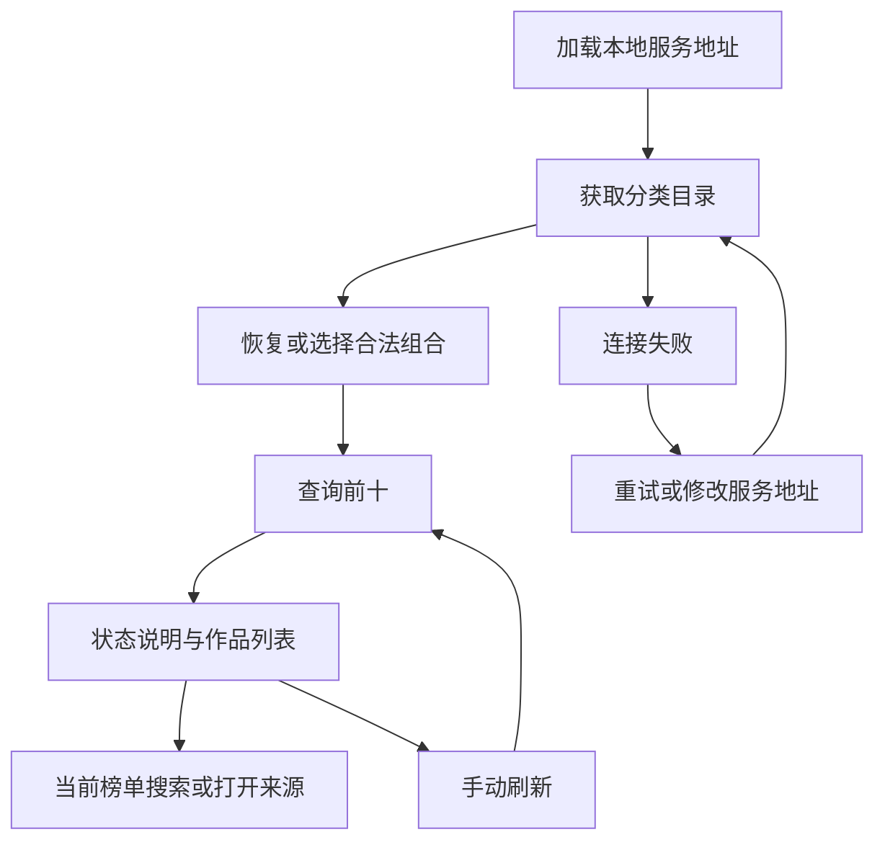

# 小说热榜 — 客户端设计报告

## 1. 目标

Android、iOS 与桌面共享网站/分类/榜单选择、前十列表、当前榜单搜索、刷新、原站跳转和可持久化的服务地址。展示加载、网络失败、部分数据、缓存、旧快照、来源受限和无搜索结果。

界面延续米白、墨绿主题，以标题、名次、作者和原始热度单位建立层级。宽度达到 960dp 时展示来源侧栏；窄屏采用横向来源选择和单列作品列表。所有分类来自服务目录，不硬编码四站分类或伪造排名。初始优先选择番茄都市日常阅读榜，目录不含该组合时选择合法回退项。

## 2. 现状分析

三端工程已初始化，macOS 曾验证欢迎页。server v0.1.0 已提供 `/api/v1/catalog`、`/api/v1/rankings`，默认端口 8000；番茄、七猫、晋江已有真实数据验证，起点返回 blocked。

保留 Kotlin 2.2.21、Compose 1.9.3、Material3 1.9.0、AGP 8.11.1、Gradle 8.14.3。新增 Ktor 3.3.2（官方 POM 使用 Kotlin 2.2.21）、Serialization 1.9.0、Coroutines 1.10.2、Datetime 0.7.1，避免为接入接口升级现有构建工具。

## 3. 数据模型与接口

`Catalog(sources)`；`Source(id,name,homeUrl,note,categories,boards)`；`Category(id,name,group,boardIds)`；`Board(id,name,metricLabel)`；`Book(rank,id,title?,author?,url,metric?,genre?,metadataStatus)`；`RankingSnapshot(sourceId,categoryId,boardId,status,message,sourceUrl,fetchedAt,sourceUpdatedAt?,fromCache,failureReason?,books)`。camelCase 与 [服务端契约](../../../../api/rankings.md) 一致。

`Selection(sourceId,categoryId,boardId)` 为完整请求身份。`RankUiState` 保存目录、选择、加载标记、排名快照、目录/榜单错误、搜索词、服务地址与设置保存错误。UI 不直接调用 HTTP；Presenter 只依赖 Repository 与 SettingsStore 接口。

| API | 用法 | 失败 |
| --- | --- | --- |
| GET /api/v1/catalog | 启动、切换地址、目录失败重试 | 网络/HTTP/格式错误单独显示，不显示假目录 |
| GET /api/v1/rankings | 合法选择 + refresh 参数 | 来源业务状态原样呈现；HTTP/契约错误为客户端服务错误 |

客户端验证目录组合、响应身份、名次顺序和状态。解析未知字段兼容新增服务字段，但不把未知状态当成功。请求预算 50 秒大于服务端默认 40 秒，连接预算 10 秒；禁用自动重定向。错误提示不包含异常堆栈或个人配置。

服务地址接受不含凭据、query、fragment 的 HTTP(S) URL，支持反向代理路径前缀。用户追加要求部署到 47.251.189.239，三端默认 `https://47.251.189.239/novelrank`。保留自定义地址；本地 Debug 调试时 Android 模拟器用 `http://10.0.2.2:8000`，iOS 模拟器/桌面用 `http://127.0.0.1:8000`。Android/iOS Release 只接受 HTTPS，不能继续使用 Debug 保存的 HTTP 地址。

## 4. 核心流程



换站/换分类自动修正不兼容榜单并清除搜索。请求采用协程取消 + 递增请求身份双重保护；更换服务地址也使先前目录/排名响应失效。刷新同一榜单保留旧列表并展示刷新状态；网络刷新失败明确标记旧内容未更新，不能将其当新结果。

搜索仅过滤当前前十的书名/作者，忽略大小写，保留原名次。空匹配显示清除入口。来源 `blocked/unavailable/parse_error` 不显示“无作品”；`partial/stale` 保留数据和缺失字段提示，来源更新时间为空时不补造。

地址保存先校验、再写入平台设置，保存失败保留当前连接。Compose 页面销毁时取消 Presenter 子协程并关闭 HTTP 客户端；首版不后台轮询。浏览器链接只允许 HTTP(S)，打开失败显示提示。

## 5. 项目结构与技术决策

```text
composeApp/src/commonMain/kotlin/com/novelrank/app/
  App.kt                    # 生命周期、状态订阅和平台注入
  model/Models.kt           # 服务端 DTO 与 Selection
  data/                     # Repository、Ktor、URL 校验、平台配置契约
  presentation/             # 可测试状态机、合法选择、时间与状态展示
  ui/                       # 自适应页面、主题
  ui/components/            # 来源、筛选、作品卡片、设置对话框与状态组件
composeApp/src/{androidMain,iosMain,desktopMain}/ # 引擎和设置存储
composeApp/src/commonTest/   # 逻辑、契约、取消/并发与地址校验
composeApp/src/desktopTest/  # Compose UI 测试
androidApp/src/{main,debug}/ # INTERNET、Debug 明文覆盖
iosApp/iosApp/              # Debug/Release 分离的 ATS 与 SwiftUI 注入
```

| 决策 | 方案 | 理由 |
| --- | --- | --- |
| 网络 | Android OkHttp / iOS Darwin / Desktop CIO | 使用 Ktor 对应平台引擎 |
| 状态 | StateFlow + 构造注入 Presenter | 易于离线验证取消和快速切换，不增加 DI 框架 |
| 本地配置 | SharedPreferences / NSUserDefaults / JVM Preferences | 只持久化服务地址，无跨端额外存储依赖 |
| UI | 共享 Material3 + 自适应侧栏/横向选项 | 保持三端交互一致，支持窄屏和宽屏 |
| 封面 | 原名次和书名字形装饰 | 不依赖第三方临时图片 URL |
| 测试 | kotlin.test、coroutines-test、Ktor MockEngine、Desktop Compose UI tests | 不依赖网站实时排名变化 |

普通验证执行 `./gradlew :composeApp:desktopTest --console=plain`，覆盖共享逻辑和 UI。按用户既有偏好不默认执行 Android assemble、Xcode 构建、发布签名或三端安装包；平台配置与源码检查的边界在验证记录中说明。桌面开发运行用于真实服务联调。

## 6. 暂不实现

| 功能 | 理由 |
| --- | --- |
| 阅读器、章节、收藏、账户、推送 | 超出分类前十查询 |
| 全站关键词搜索、跨站综合排名 | 当前搜索只过滤前十，来源口径不混排 |
| 服务端新接口、数据库 | 复用已完成 server v0.1.0；用户追加的云部署作为独立任务执行 |
| 发布签名、商店上传、安装包构建 | 本轮交付客户端实现与普通测试 |

无新增后端/API；用户追加云部署后，复用已有 API 链路验证 HTTPS 路径前缀与实际来源结果。最终质量验收 SKIPPED（沿用 quality_gate=off），不运行 Harness、覆盖率门禁或双 Agent。部署边界与实际证据见 [云部署记录](../server/deployment.md)。
