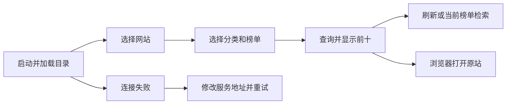

# 小说热榜 — 客户端设计报告

> 下文为完整功能设计。根据用户最新指令，本轮仅交付工程初始化与欢迎页面；网络、模型、业务 UI、配置存储和业务测试尚未实现，详见 tasks.md。

## 1. 目标

三端共享网站、分类、榜单选择及前十列表，支持当前榜单内搜索、刷新、来源跳转和可持久化服务地址。使用米白背景、墨绿主色、清晰的排名与信息层级，手机单列，桌面侧栏加内容区。

## 2. 现状分析

全新 Compose Multiplatform 工程。固定 Kotlin 2.2.21、Compose 1.9.3、Material3 1.9.0、AGP 8.11.1、Gradle 8.14.3，采用已发布的兼容版本而非动态依赖。官方依据见 [KMP 兼容表](https://kotlinlang.org/docs/multiplatform/multiplatform-compatibility-guide.html) 和 [CMP 1.9.3 发布说明](https://github.com/JetBrains/compose-multiplatform/releases/tag/v1.9.3)。Android 入口与共享库分离，iOS 使用 SwiftUI 容器嵌入 ComposeUIViewController，桌面使用 JVM。

## 3. 数据模型与接口

使用 Kotlin Serialization 映射服务端契约；Ktor 客户端按端选择 OkHttp、Darwin、CIO 引擎。领域模型独立于 UI。页面状态包含目录、当前选择、Loading/Error/RankingSnapshot，使用协程取消旧请求；每次换站重置分类与榜单到合法组合。

服务地址仅接收 HTTP(S) 且无用户信息、查询串或片段的 URL。Android 默认 `http://10.0.2.2:8080`，iOS/桌面默认 `http://localhost:8080`，通过平台存储持久化。HTTP 只用于本地开发；发布配置要求 HTTPS，Android Release 禁止明文，iOS Release 无 ATS 例外。

接口依赖：`GET /api/v1/catalog`、`GET /api/v1/rankings?source=...&category=...&board=...&refresh=...`。客户端显示服务端业务状态及来源采集时间，不把网络异常转换为成功空榜。

## 4. 核心流程



Compose 生命周期结束时取消页面请求并关闭网络客户端。快速切换时旧请求不能覆盖新选择。缓存、部分数据、旧快照都使用独立状态文案。搜索只筛选本次前十，不声称全站搜索；空匹配可清除筛选。

## 5. 项目结构与技术决策

```text
androidApp/                      # Android Activity、Manifest
composeApp/src/commonMain/       # App、model、data、presentation、ui/components
composeApp/src/androidMain/      # Android 网络和地址存储
composeApp/src/iosMain/          # iOS 网络、存储、UIViewController
composeApp/src/desktopMain/      # 桌面网络、存储、窗口入口
composeApp/src/commonTest/       # 选择校验、搜索、状态/契约测试
iosApp/                         # SwiftUI、Xcode 工程、Debug/Release 配置
```

| 决策 | 方案 | 理由 |
| --- | --- | --- |
| 分层 | UI → presenter/repository → HTTP | 网络和状态可独立测试 |
| 依赖注入 | 构造参数 | 首版无需 DI 框架 |
| 源站链接 | LocalUriHandler | 三端使用系统浏览器 |
| 配置 | expect/actual 平台存储 | 重启保留服务地址 |
| 图像 | 排名和首字封面 | 避免第三方封面临时签名及加载阻塞 |

新增 Ktor、Serialization、Coroutines，使用 kotlin.test 与 coroutines-test 做客户端契约和取消测试。遵循用户偏好，本轮不运行 Gradle/Xcode 构建；客户端测试提供精确命令并记录未执行。

## 6. 暂不实现

| 功能 | 理由 |
| --- | --- |
| 账号、订阅、收藏、推送 | 非本次查询主链 |
| 跨站综合排名 | 来源口径不可直接比较 |
| iOS 签名、应用商店发布、安装包 | 用户要求源码项目和 GitHub 上传 |

最终质量验收 `SKIPPED (quality_gate=off)`。
