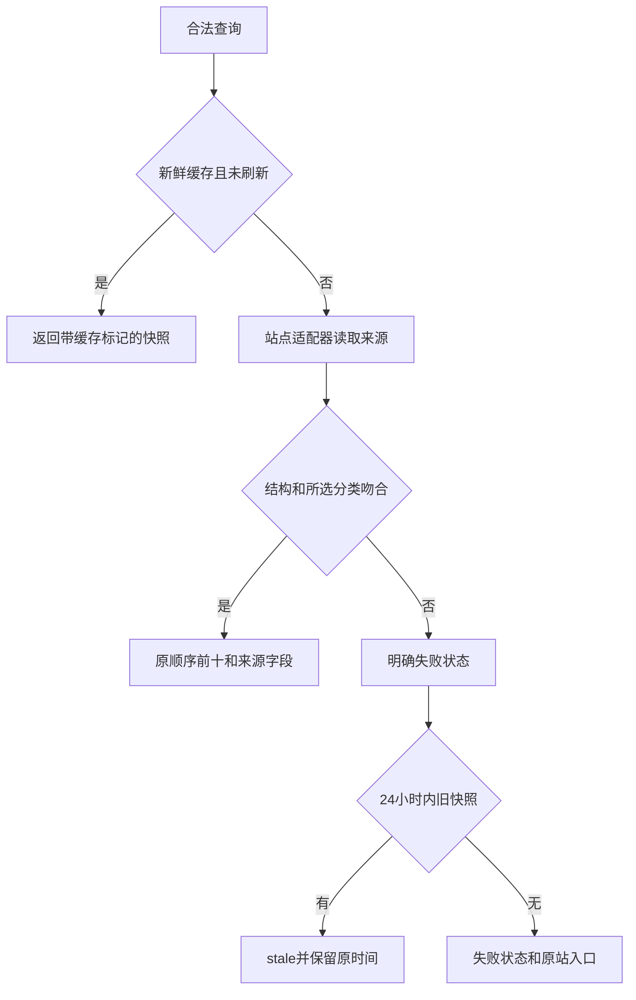

# 小说热榜 — 服务端设计报告

> 规划文档，尚未实现。用户最新指令为先初始化 CMP 工程；本轮没有服务端代码与 API。

## 1. 目标

提供四站分类目录与前十查询、来源状态、有限期缓存，支持三端共用。排名始终沿用来源顺序，返回具体网站、分类、榜单、原站 URL 和采集时间。

## 2. 现状分析

新建 Python 3.11+ / FastAPI 服务，HTTPX 负责可取消请求，BeautifulSoup 负责 HTML；无数据库、账户或部署依赖。来源公开页面存在字体编码、GB18030、验证页面和榜单口径差异。起点目前返回 HTTP 202，必须作为受限状态处理。

## 3. 数据模型与接口

`Source(id,name,homeUrl,note,categories,boards)`；`Category(id,name,group,boardIds)`；`Board(id,name,metricLabel)`；`Book(rank,id,title,author,url,metric,genre)`；`RankingSnapshot(sourceId,categoryId,boardId,status,message,sourceUrl,fetchedAt,sourceUpdatedAt,fromCache,books)`。

| API | 输入 | 输出 |
| --- | --- | --- |
| GET /health | 无 | `{ "status": "ok" }` |
| GET /api/v1/catalog | 无 | `{ "sources": [Source] }`，目录是版本化配置，不将可选择误称为当前可用 |
| GET /api/v1/rankings | source、category、board、refresh=false | RankingSnapshot，最多十条 |

非法来源/分类/组合：HTTP 400，`{"detail":{"code":"INVALID_SELECTION","message":"..."}}`；参数缺失 HTTP 422。来源失败仍返回 HTTP 200 业务状态，状态为 `blocked/unavailable/parse_error`；只有真数据使用 `ok/partial`；旧快照使用 `stale`。空解析不使用 `ok`。未知服务异常保留 HTTP 500，由客户端显示服务错误。

内存缓存使用完整查询键，TTL 15 分钟，旧快照最多保留 24 小时；同查询并发合并。失败缓存 60 秒，手动刷新也遵守最短重试间隔，避免每次点击直接请求来源。总并发和每站请求间隔有上限。使用 UTC ISO 8601 时间；来源更新时间未知时为空，不能冒用采集时间。

## 4. 核心流程



番茄从榜单 SSR 获取分类与名次，必要时从公开作品详情 SSR 补全书名，详情失败只降级对应条目。七猫保留男女频大热榜，并将类型页明确命名为「分类热度排序」。晋江从分类收入金榜分组取前十，不将全站月榜按类型过滤。起点使用分类月票/畅销榜 URL，访问受限则停止并报告。

## 5. 项目结构与技术决策

```text
server/app/
  main.py           # 路由与生命周期
  models.py         # 对外契约
  catalog.py        # 支持的真实来源组合
  service.py        # 缓存与状态流
  sources/          # 按站点独立适配器及公共 HTTP 边界
server/tests/       # 构造页面与故障注入，不依赖在线榜单
scripts/            # 启动、真实来源探测、API 链路
```

| 决策 | 方案 | 理由 |
| --- | --- | --- |
| 解析位置 | 独立服务 | 网站变化无需三端重新发布 |
| 存储 | 有限期内存缓存 | 首版无迁移成本，不永久保存站点内容 |
| 请求边界 | 固定可信域名与目录参数 | 不接收任意抓取 URL |
| 榜单真实性 | 来源语义与状态外显 | 避免混合单位和假成功 |

新增依赖：FastAPI、uvicorn、httpx、beautifulsoup4、pytest。测试包含超时、受限、错分类、乱码、缓存隔离、并发与过期场景。

## 6. 暂不实现

| 功能 | 理由 |
| --- | --- |
| 章节、全文、登录或付费内容 | 用户只需排名元数据 |
| 验证码处理和反爬绕过 | 受限状态明确返回 |
| 持续全站采集、历史趋势、数据库 | 当前仅按需查询 |
| 公网部署与账户认证 | 先交付本地可运行工程和 GitHub 源码 |

最终质量验收 `SKIPPED (quality_gate=off)`；普通测试与 API 链路保留。
