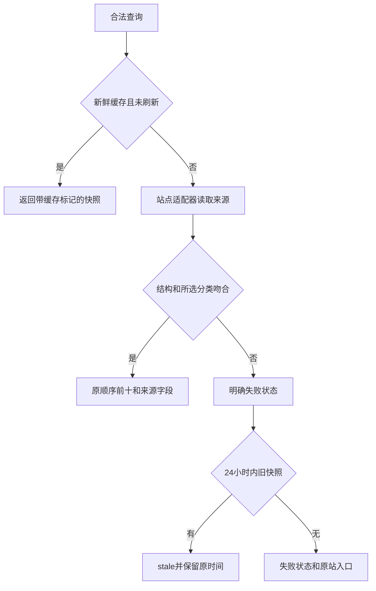

# 小说热榜 — 服务端设计报告

> 当前实施依据：server v0.1.0 和共享客户端已交付；用户追加修复起点，并明确移除七猫。只更新独立榜单服务。

## 1. 目标

提供起点、番茄、晋江三站分类目录与前十查询、来源状态、有限期缓存，支持三端共用。排名始终沿用来源顺序，返回具体网站、分类、榜单、原站 URL 和采集时间。七猫从目录、适配器和请求白名单移除，旧请求在网络前按未知来源返回 400。

## 2. 现状分析

已有 Python 3.11+ / FastAPI 服务，HTTPX 负责可取消请求，BeautifulSoup 负责 HTML；无数据库或账户。服务部署在独立 venv/systemd 中，通过 `/novelrank/` 提供 API。来源公开页面存在字体编码、GB18030、验证页面和榜单口径差异。起点 PC 页面返回 HTTP 202，官方移动端普通 GET 可取得公开榜单，使用移动端替换原 PC 解析；遇到访问限制仍返回真实失败状态。

## 3. 数据模型与接口

`Source(id,name,homeUrl,note,categories,boards)`；`Category(id,name,group,boardIds)`；`Board(id,name,metricLabel)`；`Book(rank,id,title,author,url,metric,genre,metadataStatus)`；`RankingSnapshot(sourceId,categoryId,boardId,status,message,sourceUrl,fetchedAt,sourceUpdatedAt,fromCache,books,failureReason)`。

| API | 输入 | 输出 |
| --- | --- | --- |
| GET /health | 无 | `{ "status": "ok" }` |
| GET /api/v1/catalog | 无 | `{ "sources": [Source] }`，目录是版本化配置，不将可选择误称为当前可用 |
| GET /api/v1/rankings | source、category、board、refresh=false | RankingSnapshot，最多十条 |

非法来源/分类/组合：HTTP 400，`{"detail":{"code":"INVALID_SELECTION","message":"..."}}`；参数缺失 HTTP 422。来源失败仍返回 HTTP 200 业务状态，状态为 `blocked/unavailable/parse_error`；只有真数据使用 `ok/partial`；旧快照使用 `stale`。空解析不使用 `ok`。未知服务异常保留 HTTP 500，由客户端显示服务错误。

`title/author/metric/genre/sourceUpdatedAt` 允许为空；字段未取得时不填造数据，`metadataStatus=partial` 标记缺失标题/作者。`failureReason` 在失败或旧快照时记录具体上游状态；失败时 `fetchedAt` 表示尝试结束时间，旧快照保留原采集时间。

内存缓存使用完整查询键，TTL 15 分钟，旧快照最多保留 24 小时；同查询并发合并。失败缓存 60 秒，手动刷新也遵守最短重试间隔，避免每次点击直接请求来源。总并发和每站请求间隔有上限。网络只访问固定官方域名，重定向逐跳校验；响应体与整次查询时间有上限。服务关闭取消进行中任务并关闭连接池。缓存为单进程内存，开发启动使用一个 worker。使用 UTC ISO 8601 时间；来源更新时间未知时为空，不能冒用采集时间。

## 4. 核心流程



番茄从榜单 SSR 获取分类与名次，必要时从公开作品详情 SSR 补全书名，详情失败只降级对应条目。晋江从分类收入金榜分组取前十，不将全站月榜按类型过滤。

起点只读取 `m.qidian.com` 公开移动页面中的 `vite-plugin-ssr_pageContext` JSON，不执行页面脚本。保留 14 类和月票/畅销两个榜单，校验网站/频段、路由、分类 ID/名称、第一页、原始名次、作品 ID；月票榜还校验 UTC+8 当前月份。使用不带固定年月的当前榜单 URL，避免把上月榜当成本月。SSR 缺失值不能作为书名/作者返回；月票数值缺失为 partial，畅销榜未公开数值时为 null，可保持 ok。

## 5. 项目结构与技术决策

```text
server/app/
  main.py           # 路由与生命周期
  models.py         # 对外契约
  catalog.py        # 支持的真实来源组合
  config.py         # 可选环境变量与边界校验
  service.py        # 缓存与状态流
  sources/          # 按站点独立适配器及公共 HTTP 边界
server/tests/       # 构造页面与故障注入，不依赖在线榜单
scripts/            # 启动、真实来源探测、API 链路
```

| 决策 | 方案 | 理由 |
| --- | --- | --- |
| 解析位置 | 独立服务 | 网站变化无需三端重新发布 |
| 存储 | 有限期内存缓存 | 首版无迁移成本，不永久保存站点内容 |
| 请求边界 | 固定可信域名与目录参数 | 不接收任意抓取 URL |
| 榜单真实性 | 来源语义与状态外显 | 避免混合单位和假成功 |

依赖：FastAPI、uvicorn、httpx、beautifulsoup4；测试使用 pytest、pytest-asyncio。路由依赖 service，service 依赖只负责抓取/解析的 sources；sources 不依赖 HTTP 路由。无持久存储，因此无 SQL 表或迁移。测试包含超时、受限、错分类、乱码、缓存隔离、并发与过期场景。

部署更新采用独立 release 与原子切换软链，复用依赖一致的 NovelRank venv；先以受资源限制的临时服务验证健康/目录，再只重启 `novelrank.service`。保留旧 release 以便回滚，核对其他服务 PID/状态、Nginx 配置哈希和根路径认证响应。当前路由与资源限制无需修改。

## 6. 暂不实现

| 功能 | 理由 |
| --- | --- |
| 章节、全文、登录或付费内容 | 用户只需排名元数据 |
| 验证码处理和反爬绕过 | 受限状态明确返回 |
| 持续全站采集、历史趋势、数据库 | 当前仅按需查询 |
| 账户认证、其他服务变更 | 现有公开榜单 API；本轮只更新 NovelRank |
| 七猫接入或放行申请 | 用户已明确移除该来源 |

最终质量验收 `SKIPPED (quality_gate=off)`；普通测试与 API 链路保留。
